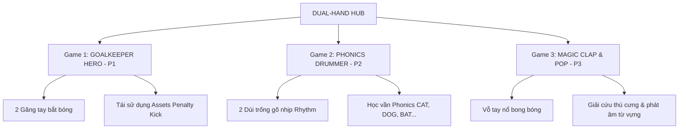

# Kế Hoạch Triển Khai: Phân Hệ Game Cử Chỉ 2 Bàn Tay (Dual-Hand Motion Hub)

> **Tổ chức:** Enspire Digital  
> **Nền tảng:** Flutter Motion Game Hub  
> **Mục tiêu:** Phát triển phân hệ trò chơi tương tác chuyển động 2 bàn tay kết hợp học Tiếng Anh (Phonics & Từ vựng) dành cho trẻ em mầm non và tiểu học.

---

## I. Tổng Quan Kiến Trúc (Architecture Overview)

Phân hệ game 2 tay sẽ được tách thành một **Hub riêng biệt** (`DualHandHubScreen`) để:
1. **Tối ưu trải nghiệm góc nhìn (FOV):** Hướng dẫn bé lùi ra xa camera khoảng `0.8m - 1.2m` để camera thu trọn vẹn cả 2 cánh tay.
2. **Tiết kiệm tài nguyên:** Chỉ khởi chạy MediaPipe với `numHands: 2` (GPU Delegate) khi vào Hub 2 tay; các game 1 tay và khuôn mặt vẫn chạy ở chế độ tiết kiệm năng lượng.
3. **Độc lập mã nguồn:** Không làm ảnh hưởng đến các game đang hoạt động ổn định (*Fruits Kick*, *Egg Smasher*).

```
                        [ LAUNCHER / PORTAL ]
                                  │
         ┌────────────────────────┴────────────────────────┐
         ▼                                                 ▼
[ SINGLE MOTION HUB ]                             [ DUAL-HAND HUB ]
• Face / 1-Hand Gestures                          • 2-Hands Gestures (numHands: 2)
• Fruits Kick, Egg Smasher                        1. 🧤 Goalkeeper Hero (P1)
                                                  2. 🥁 Phonics Drummer (P2)
                                                  3. 👏 Magic Clap & Pop (P3)
```

---

## II. Nền Tảng Kỹ Thuật 2 Bàn Tay (Dual-Hand Motion Core)

### 1. Dữ liệu trạng thái (`DualHandMotionState`)
Mở rộng cấu trúc dữ liệu để theo dõi độc lập 2 bàn tay:

| Dữ liệu | Kiểu | Mô tả |
| :--- | :--- | :--- |
| `leftHandDetected` / `rightHandDetected` | `bool` | Trạng thái phát hiện từng tay |
| `leftHandX`, `leftHandY` | `double` | Tọa độ chuẩn hóa `[-1.0 .. 1.0]` tay trái |
| `rightHandX`, `rightHandY` | `double` | Tọa độ chuẩn hóa `[-1.0 .. 1.0]` tay phải |
| `isLeftFist` / `isRightFist` | `bool` | Cử chỉ Nắm đấm từng tay (Fist trigger) |
| `isLeftDownSlam` / `isRightDownSlam` | `bool` | Cú hạ tay/gõ dùi trống từng tay |
| `clapDistance` | `double` | Khoảng cách tương đối giữa 2 tâm bàn tay |
| `isClapTriggered` | `bool` | Cử chỉ Vỗ tay (khoảng cách thu hẹp đột ngột) |

### 2. Thuật toán nhận diện cử chỉ 2 tay
* **Phân định Tay Trái - Tay Phải:** Dựa vào thuộc tính `handedness` của MediaPipe ("Left"/"Right"), kết hợp so sánh tọa độ `X` trên màn hình để tránh hiện tượng hoán đổi danh tính (identity swap) khi 2 tay đan chéo.
* **Cử chỉ Vỗ tay (Clap Detection):** 
  $$\Delta D = \sqrt{(X_{left} - X_{right})^2 + (Y_{left} - Y_{right})^2}$$
  Khi $\Delta D$ giảm nhanh từ $> 0.35$ xuống $< 0.12$ trong khoảng thời gian $< 200ms$, kích hoạt sự kiện `Clap`.
* **Cử chỉ Gõ trống (Drum Slam):** Tái sử dụng thuật toán `Downward Slam` (lên cò khi tay ở trên cao, kích hoạt khi hạ tay dứt khoát với vận tốc $> 0.40/s$).

---

## III. Chi Tiết 3 Tựa Game Được Chọn



---

### 🧤 Game 1: GOALKEEPER HERO (Siêu Thủ Môn 2 Găng)
> **Độ ưu tiên:** **P1 (MVP triển khai đầu tiên)** — Tận dụng tối đa tài nguyên có sẵn của game *Fruits Kick*.

* **Bối cảnh & Đồ họa:**
  * Bé là thủ môn đứng trước khung thành, điều khiển **2 chiếc găng tay khổng lồ** (Găng Xanh Cyan bên trái & Găng Đỏ/Cam bên phải).
  * Tận dụng lại 100% sân cỏ, khán đài, bóng 3D, hiệu ứng lưới rung và khán giả reo hò từ [penalty_kick](file:///d:/flutter_workspace/motion_game_hub/lib/games/penalty_kick/).
* **Cơ chế chơi 2 tay:**
  * Các cầu thủ thú cưng sút bóng về 3 hướng (Góc cao, Góc thấp, Biên trái, Biên phải, hoặc Chính diện).
  * Bé di chuyển 2 tay tự do trong không gian để cản phá:
    * Bóng bay lệch bên trái $\rightarrow$ Vung tay trái chặn bóng.
    * Bóng bay lệch bên phải $\rightarrow$ Vung tay phải cản bóng.
    * Bóng sút căng chính diện $\rightarrow$ **Chụm 2 tay lại trước ngực để ôm dính bóng!**
* **Yếu tố Tiếng Anh:**
  * Loa đọc: *"Catch the APPLE!"*.
  * 2 hoặc 3 quả bóng bay tới (1 quả mang hình Apple, các quả khác là bom/quả sai). Bé phải cản đúng quả Apple và né/gạt quả bom ra ngoài.
* **Luật chơi:** Endless Mode 3 mạng, chuỗi bắt dính liên tiếp (Clean Sheet Streak), tính điểm theo phản xạ bắt bóng nhanh.

---

### 🥁 Game 2: PHONICS DRUMMER (Thần Đồng Gõ Trống 2 Tay)
> **Độ ưu tiên:** **P2** — Trò chơi âm nhạc & nhịp điệu (Rhythm) cực kỳ kích thích vận động cho trẻ em.

* **Bối cảnh & Đồ họa:**
  * Bé là nhạc công gấu/thỏ trên sân khấu âm nhạc rực rỡ đèn neon.
  * Trước mặt bé là dàn trống hoạt hình: **Trống Đỏ (bên trái)**, **Trống Xanh (bên phải)**, và **Chiêng Vàng (ở giữa)**.
  * Hai bàn tay của bé gắn liền với 2 chiếc dùi trống phép thuật phát sáng.
* **Cơ chế chơi 2 tay:**
  * Các nốt nhạc, chữ cái hoặc quả cầu sao rơi từ trên xuống theo nhịp điệu bài hát thiếu nhi vui nhộn.
  * Bé hạ tay xuống mặt trống tương ứng đúng thời điểm (vạch nhịp Hit Zone):
    * Hạ tay trái $\rightarrow$ Trống trái kêu *"Tùm!"*, mặt trống nảy lên, sao bay lấp lánh.
    * Hạ tay phải $\rightarrow$ Trống phải kêu *"Chát!"*.
    * Hạ cả 2 tay cùng lúc $\rightarrow$ Tiếng trống kép *"Rầm! 🎉"*.
* **Yếu tố Tiếng Anh:**
  * **Ghép vần Phonics:** Nốt rơi mang chữ cái `C` (bên trái) $\rightarrow$ `A` (ở giữa) $\rightarrow$ `T` (bên phải). Bé gõ lần lượt 3 trống để phát âm: *"C - A - T $\rightarrow$ CAT!"* kèm hình ảnh chú mèo hiện lên nhảy múa.
* **Luật chơi:** Tính điểm Perfect / Great theo độ chuẩn xác của nhịp gõ, combo nhịp càng dài điểm càng cao.

---

### 👏 Game 3: MAGIC CLAP & POP (Vỗ Tay Nổ Bong Bóng)
> **Độ ưu tiên:** **P3** — Cử chỉ bản năng tự nhiên nhất của trẻ nhỏ.

* **Bối cảnh & Đồ họa:**
  * Khung cảnh thế giới bong bóng thần tiên dưới đáy đại dương hoặc trên bầu trời mây kẹo ngọt.
  * Các bong bóng xà phòng ngũ sắc chứa hình các loài động vật hoặc đồ vật lơ lửng bay lên từ đáy màn hình.
* **Cơ chế chơi 2 tay:**
  * Hai bàn tay bé di chuyển mở ra như 2 chiếc quạt thần bao bọc lấy quả bóng.
  * **Động tác Vỗ tay (Clap):** Bé vỗ 2 tay vào nhau thật nhanh $\rightarrow$ Quả bóng bị ép vỡ *"BÙM!"*, mảnh nước bắn tung toé, pháo hoa rực rỡ.
* **Yếu tố Tiếng Anh:**
  * Loa đọc tên con vật (ví dụ: *"Find the LION!"*).
  * Khi bé vỗ vỡ đúng bóng Lion: Con sư tử được giải cứu nhảy ra gầm *"Roar!"* và giọng đọc phát âm lại từ vựng để củng cố trí nhớ.
  * Nếu vỗ trúng bóng chứa quả cầu gai/mực đen: Mực bắn làm mờ màn hình 1.5s và trừ 1 mạng.
* **Luật chơi:** Endless Mode 3 mạng, bong bóng bay nhanh dần theo thời gian, xuất hiện các bong bóng đặc biệt (x2 điểm, đóng băng thời gian).

---

## IV. Lộ Trình Triển Khai (Milestones & Roadmap)

```
[ Giai đoạn 1: Core 2 Tay ]
   ├── Mở rộng MotionState (Left/Right Hand, Clap, DownwardSlam)
   ├── Cập nhật MotionController (MediaPipe numHands: 2, GPU Delegate, 30 FPS)
   └── Thiết kế giao diện DualHandHubScreen & PiP Camera 2 Reticles
              │
              ▼
[ Giai đoạn 2: MVP Goalkeeper Hero ]
   ├── Tạo GoalkeeperEngine & GoalkeeperCanvas
   ├── Tích hợp 2 Găng tay bắt bóng & Vật lý bóng bay
   └── Hoàn thiện âm thanh, HUD 3 mạng & High Score
              │
              ▼
[ Giai đoạn 3: Phonics Drummer & Magic Clap ]
   ├── Phát triển Phonics Drummer (Rhythm Engine + SoundPool Trống)
   └── Phát triển Magic Clap (Bubble Spawner + Thuật toán Clap Distance)
              │
              ▼
[ Giai đoạn 4: Đánh bóng & Mở rộng Voice Recognition ]
   ├── Kiểm thử hiệu năng trên máy thật (Snapdragon 8 Elite & máy tầm trung)
   └── Chuẩn bị kiến trúc Microphone / Speech-to-Text cho tương lai
```

---

## V. Đánh Giá Độ Khả Thi Kỹ Thuật

| Hạng mục | Đánh giá | Giải pháp kỹ thuật |
| :--- | :---: | :--- |
| **FPS & Hiệu năng** | ✅ **Rất tốt** | Nhờ GPU Delegate đã cấu hình, inference 2 tay trên chip Adreno chỉ mất ~6-8ms, duy trì ổn định **30 FPS**. |
| **Tái sử dụng mã nguồn** | ✅ **Rất cao** | Game 1 tận dụng 80% từ *Penalty Kick*; Game 2 tái sử dụng thuật toán *Downward Slam* đã có; Game 3 chỉ cần tính khoảng cách Euclidean. |
| **Trải nghiệm trẻ em** | ✅ **Tự nhiên** | Động tác bắt bóng, gõ trống, vỗ tay là các phản xạ tự nhiên của trẻ em, không đòi hỏi hướng dẫn phức tạp. |
| **Khả năng mở rộng Voice** | ✅ **Sẵn sàng** | Phân hệ tách biệt cho phép cắm module Voice Recognition vào sau này mà không gây xung đột tài nguyên. |
